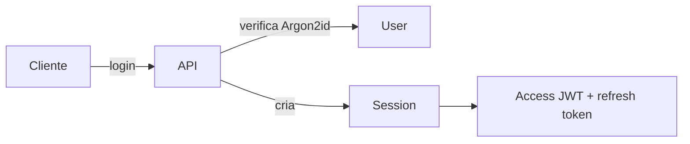
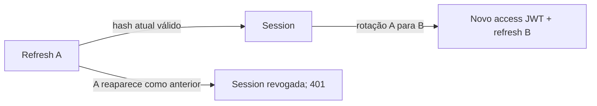

# Session Management API

API backend para autenticação e gerenciamento de múltiplas sessões independentes por usuário. Cada login cria uma Session persistente: o usuário pode manter acessos simultâneos e listar ou revogar cada sessão individualmente.

## Stack e escopo

NestJS, TypeScript, MySQL, TypeORM, Docker Compose, JWT, Passport, Argon2id, Jest e Swagger. Helmet e `@nestjs/throttler` aplicam proteções HTTP básicas.

O MVP oferece cadastro, login, sessões independentes, access JWT, refresh token opaco com rotação e detecção de reuse, logout da sessão atual, listagem e revogação individual de sessões, endpoint protegido, migrations e testes unitários e E2E com MySQL real.

## Como funciona

### Password

No cadastro, o email é normalizado com `trim().toLowerCase()`. A senha recebida é transformada em `passwordHash` com Argon2id antes da persistência. A senha pura nunca é armazenada; a biblioteca gerencia o salt. Argon2id foi escolhido por exigir memória durante a verificação, o que dificulta ataques paralelos contra hashes vazados. No login, o hash é selecionado explicitamente e verificado; usuário inexistente e senha incorreta recebem a mesma resposta externa.

### Access token

O access token é um JWT assinado com HS256, válido por 10 minutos. As claims principais são `sub` (ID do User) e `sid` (ID da Session), além de `iat`, `exp`, `iss` e `aud`. Issuer, audience, assinatura, algoritmo e expiração são verificados. O JWT não é persistido; endpoints protegidos validam o token sem consultar User ou Session no banco.

Revogar uma Session bloqueia novos refreshes imediatamente, mas um access JWT já emitido pode continuar válido até expirar, por até 10 minutos.

### Refresh token e Session

O refresh token opaco tem o formato conceitual `sessionId.secret`. O `sessionId` localiza a Session; o `secret` é gerado com 32 bytes aleatórios e codificado em base64url. Somente SHA-256 do texto do secret transportado é armazenado. Nem o token completo nem o secret puro são persistidos.

Cada login cria uma nova Session com expiração **absoluta de 30 dias**. Refresh não estende `expiresAt`. `lastUsedAt` registra o login e a última rotação. A listagem inclui somente sessões do usuário autenticado, não revogadas e não expiradas, ordenadas da mais recente para a mais antiga; `current` compara o ID da sessão com `sid` do JWT.



### Rotação, reuse e concorrência

Em um refresh válido, o hash do token atual `A` passa para `previousRefreshTokenHash`; um novo secret gera o token atual `B`. A resposta contém novo access JWT e novo refresh token com o **mesmo sessionId**. Se `A` reaparecer, o reuse do token imediatamente anterior revoga a Session e a API responde 401. Um secret desconhecido recebe 401 sem revogar a Session. O MVP armazena apenas o hash anterior: isso não detecta todo replay histórico.



A rotação usa uma transação e `pessimistic_write`, que corresponde a `SELECT ... FOR UPDATE` no MySQL/InnoDB. Requests concorrentes esperam o lock e leem o estado atualizado: dois refreshes com `A` não podem consumi-lo como token atual com sucesso. Há teste E2E com duas requests simultâneas contra MySQL real; pela política de reuse, a segunda pode revogar a Session após a primeira rotação.

## Modelo de dados

| Modelo  | Campos                                                                                                              |
| ------- | ------------------------------------------------------------------------------------------------------------------- |
| User    | `id`, `email`, `passwordHash`, `createdAt`, `updatedAt`                                                             |
| Session | `id`, `userId`, `refreshTokenHash`, `previousRefreshTokenHash`, `createdAt`, `lastUsedAt`, `expiresAt`, `revokedAt` |

Um User possui várias Sessions (`1:N`). `email` é único. Os hashes não são selecionados automaticamente pelo TypeORM. O schema é criado por migration; `synchronize` permanece `false`.

## Endpoints

| Método | Endpoint         | Autenticação          | Descrição                                                                 |
| ------ | ---------------- | --------------------- | ------------------------------------------------------------------------- |
| POST   | `/auth/register` | Não                   | Cadastra usuário; retorna ID, email e data de criação (201).              |
| POST   | `/auth/login`    | Não                   | Valida credenciais, cria Session e retorna access e refresh tokens (200). |
| POST   | `/auth/refresh`  | Refresh token no body | Rotaciona refresh token e emite novo par (200).                           |
| POST   | `/auth/logout`   | Bearer access JWT     | Revoga a Session atual, de forma idempotente (204).                       |
| GET    | `/auth/me`       | Bearer access JWT     | Retorna `userId` e `sessionId` do JWT (200).                              |
| GET    | `/sessions`      | Bearer access JWT     | Lista sessões próprias ativas (200).                                      |
| DELETE | `/sessions/:id`  | Bearer access JWT     | Revoga uma Session própria; aceita a atual (204).                         |
| GET    | `/health`        | Não                   | Retorna `{ "status": "ok" }` (200).                                       |

Na revogação por ID, uma Session inexistente e uma de outro usuário produzem a mesma resposta 404. Os principais erros são 400 (entrada inválida), 401 (autenticação inválida), 404 (Session não encontrada ou não pertencente ao usuário), 409 (email já cadastrado), 413 (body acima do limite) e 429 (rate limit).

### Exemplos de uso (PowerShell)

Substitua os placeholders pelos valores da sua instalação. Use uma senha local de 8 a 128 caracteres; não publique credenciais ou tokens.

```powershell
$base = 'http://localhost:3000'
$credentials = @{ email = 'user@example.com'; password = '<PASSWORD>' } | ConvertTo-Json

# 1. Cadastro
Invoke-RestMethod -Method Post -Uri "$base/auth/register" -ContentType 'application/json' -Body $credentials

# 2. Login; cada chamada cria uma Session nova
$login = Invoke-RestMethod -Method Post -Uri "$base/auth/login" -ContentType 'application/json' -Body $credentials
$access = $login.accessToken
$refresh = $login.refreshToken

# 3. Endpoint protegido
Invoke-RestMethod -Uri "$base/auth/me" -Headers @{ Authorization = "Bearer $access" }

# 4. Refresh; substitua o par anterior pelo novo
$rotated = Invoke-RestMethod -Method Post -Uri "$base/auth/refresh" -ContentType 'application/json' -Body (@{ refreshToken = $refresh } | ConvertTo-Json)
$access = $rotated.accessToken
$refresh = $rotated.refreshToken

# 5. Listar sessões ativas
$sessions = Invoke-RestMethod -Uri "$base/sessions" -Headers @{ Authorization = "Bearer $access" }

# 6. Revogar uma Session própria escolhida da lista
$sessionId = '<SESSION_ID>'
Invoke-RestMethod -Method Delete -Uri "$base/sessions/$sessionId" -Headers @{ Authorization = "Bearer $access" }

# 7. Logout da Session associada ao access JWT atual
Invoke-RestMethod -Method Post -Uri "$base/auth/logout" -Headers @{ Authorization = "Bearer $access" }
```

O refresh token também pode ser representado nos exemplos como `<REFRESH_TOKEN>` e o access JWT como `<ACCESS_TOKEN>`; são credenciais e devem ser protegidas pelo cliente.

## Security decisions

- Argon2id protege hashes de senha; o salt é gerenciado pela biblioteca.
- Secrets de refresh vêm de `randomBytes(32)`; o banco guarda somente SHA-256 do secret, o hash atual e o imediatamente anterior.
- Refresh rotaciona a cada uso válido; reuse do token anterior revoga a Session.
- Access JWT tem TTL curto, HS256 fixado e verifica issuer e audience. O secret é obrigatório, tem no mínimo 32 bytes e vem do ambiente.
- Login e refresh respondem genericamente a credenciais inválidas. O login executa uma verificação Argon2id dummy para usuário inexistente, reduzindo a diferença óbvia de tempo.
- Listagem e revogação exigem identidade do JWT; a operação de revogação inclui ownership na condição de escrita.
- Cadastro, login e refresh aceitam até **20 requests por minuto, por IP e por endpoint**. O contador fica em memória, sem armazenamento distribuído.
- Helmet fornece headers de segurança; corpos JSON e URL encoded têm limite de **8 KiB**. O `ValidationPipe` rejeita campos extras. CORS não é habilitado, pois o MVP não tem frontend.
- TypeORM usa `synchronize: false`; migrations definem o schema. Senhas de banco e secret JWT vêm de variáveis de ambiente.

### Threat model resumido

| Ameaça                | Mitigação                                                                | Limitação residual                                                                               |
| --------------------- | ------------------------------------------------------------------------ | ------------------------------------------------------------------------------------------------ |
| Vazamento do banco    | Senhas em Argon2id; somente hashes de refresh no banco.                  | Emails e metadados de sessão podem ser expostos; senhas fracas ainda podem ser atacadas offline. |
| Senha fraca           | Argon2id e rate limiting no login.                                       | A API não exige política de complexidade nem bloqueia contas.                                    |
| Access token roubado  | TTL de 10 minutos e validação de assinatura, issuer e audience.          | Token válido pode ser usado até expirar; o cliente precisa proteger o token e usar TLS.          |
| Refresh token roubado | Secret aleatório, rotação e revogação ao detectar reuse do anterior.     | O primeiro uso pelo atacante pode ter sucesso; reuse fora da janela anterior não é identificado. |
| Replay de refresh     | Um token atual só rotaciona uma vez; reuse do anterior revoga a Session. | Não existe histórico completo de tokens.                                                         |
| Brute force           | Limites nos endpoints sensíveis, erro genérico e Argon2id dummy.         | Contador em memória reinicia e não é compartilhado entre instâncias.                             |
| Session revogada      | Novos refreshes falham imediatamente.                                    | Access JWT já emitido pode continuar válido até o TTL.                                           |

### Trade-offs do MVP

| Decisão                  | Vantagem                                              | Limite                                                      |
| ------------------------ | ----------------------------------------------------- | ----------------------------------------------------------- |
| Access JWT stateless     | Sem lookup de Session em cada request protegida.      | Revogação não invalida o JWT já emitido por até 10 minutos. |
| Rate limiting em memória | Simples para uma única instância.                     | Reinicia com a aplicação e não é compartilhado.             |
| Reuse do hash anterior   | Detecta replay imediato sem família de tokens.        | Não detecta todo replay histórico.                          |
| Expiração absoluta       | Uma Session tem duração máxima previsível de 30 dias. | Refresh não prolonga a Session.                             |

Possíveis evoluções fora deste MVP: MFA/2FA, recuperação de senha, verificação de email, OAuth/social login, Redis para rate limiting distribuído, identificação de dispositivo/user-agent, logout ou revogação em massa, assinatura JWT assimétrica caso a arquitetura passe a exigir, histórico ou família de refresh tokens e observabilidade.

## Execução local

Requisitos: Node.js **20 ou superior** (NestJS 11), npm e Docker com Compose. O projeto foi validado com Node.js 24 e MySQL `8.4.11`. O Compose sobe **somente** o MySQL, publicado em `127.0.0.1:3307` por padrão. Use o PowerShell para os comandos abaixo.

1. Instale as dependências: `npm ci`.
2. Copie o exemplo: `Copy-Item .env.example .env`. Edite `.env` com uma senha **local** para `DB_PASSWORD` e um segredo aleatório próprio de pelo menos 32 bytes para `JWT_ACCESS_SECRET`. Não versione `.env`. A aplicação não carrega esse arquivo automaticamente.
3. Carregue as variáveis no processo do PowerShell, sem imprimi-las:

   ```powershell
   Get-Content .env | Where-Object { $_ -match '^[A-Za-z_][A-Za-z0-9_]*=' } | ForEach-Object {
     $name, $value = $_ -split '=', 2
     [Environment]::SetEnvironmentVariable($name, $value, 'Process')
   }
   ```

4. No **mesmo terminal**, suba o banco e espere `healthy` em `docker compose ps`:

   ```powershell
   docker compose up -d mysql
   docker compose ps
   ```

5. Crie o schema e inicie a API:

   ```powershell
   npm run migration:run
   npm run start:dev
   ```

6. Acesse `http://localhost:3000/v1/docs/swagger`. Swagger fica disponível quando `NODE_ENV` é diferente de `production` e é desabilitado em produção. `PORT` pode mudar a porta HTTP.

As variáveis de `.env.example` são:

| Variável            | Uso                                                                  |
| ------------------- | -------------------------------------------------------------------- |
| `DB_HOST`           | Host MySQL; `127.0.0.1` para o Compose local.                        |
| `DB_PORT`           | Porta publicada; padrão local `3307`.                                |
| `DB_USER`           | Usuário MySQL local.                                                 |
| `DB_PASSWORD`       | Senha local definida por você; exigida pelo Compose e pela API.      |
| `DB_NAME`           | Banco; `session_management_e2e` no ambiente local de E2E.            |
| `JWT_ACCESS_SECRET` | Secret aleatório próprio, mínimo de 32 bytes; o exemplo deixa vazio. |
| `JWT_ISSUER`        | Emissor esperado e emitido no access JWT.                            |
| `JWT_AUDIENCE`      | Público esperado e emitido no access JWT.                            |
| `NODE_ENV`          | Opcional; `production` desabilita Swagger.                           |
| `PORT`              | Opcional; porta HTTP, padrão `3000`.                                 |

O volume Docker preserva dados locais entre reinícios. `npm run migration:revert` desfaz a última migration; use apenas em banco local descartável quando essa remoção for intencional. Em seguida, `npm run migration:run` a reaplica. Não use `synchronize: true`.

## Testes e qualidade

Os unitários não precisam de MySQL. Os E2E usam **MySQL real local** com migration aplicada; limpam `sessions` e `users` entre cenários. Use somente um banco local descartável, sem dados que queira preservar. A suíte recusa `DB_HOST` fora de `127.0.0.1`/`localhost` e `DB_NAME` diferente de `session_management_e2e`. Ela cobre constraint única, FK/`ON DELETE RESTRICT`, fluxos HTTP, rotação e revogação persistida após reuse, inclusive duas requests concorrentes de refresh no MySQL real.

Com o ambiente local carregado no mesmo terminal e o MySQL saudável:

```powershell
npm run build
$env:ESLINT_USE_FLAT_CONFIG = 'false'
.\node_modules\.bin\eslint.cmd 'src/**/*.ts' 'test/**/*.ts'
npx prettier --check .
npm test -- --runInBand
npm run test:e2e
```

O script `npm run lint` contém `--fix`; o comando acima executa ESLint em modo somente leitura. Não é necessário executar migration antes de cada teste E2E: a suíte limpa os dados e exige que o schema já esteja migrado.
